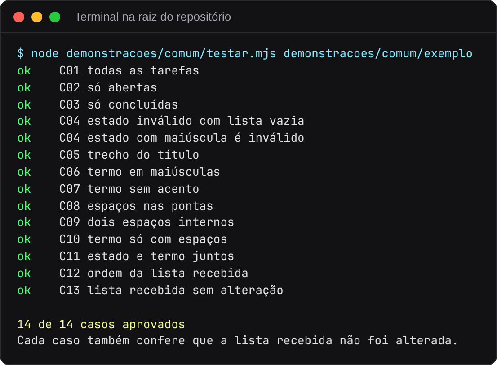
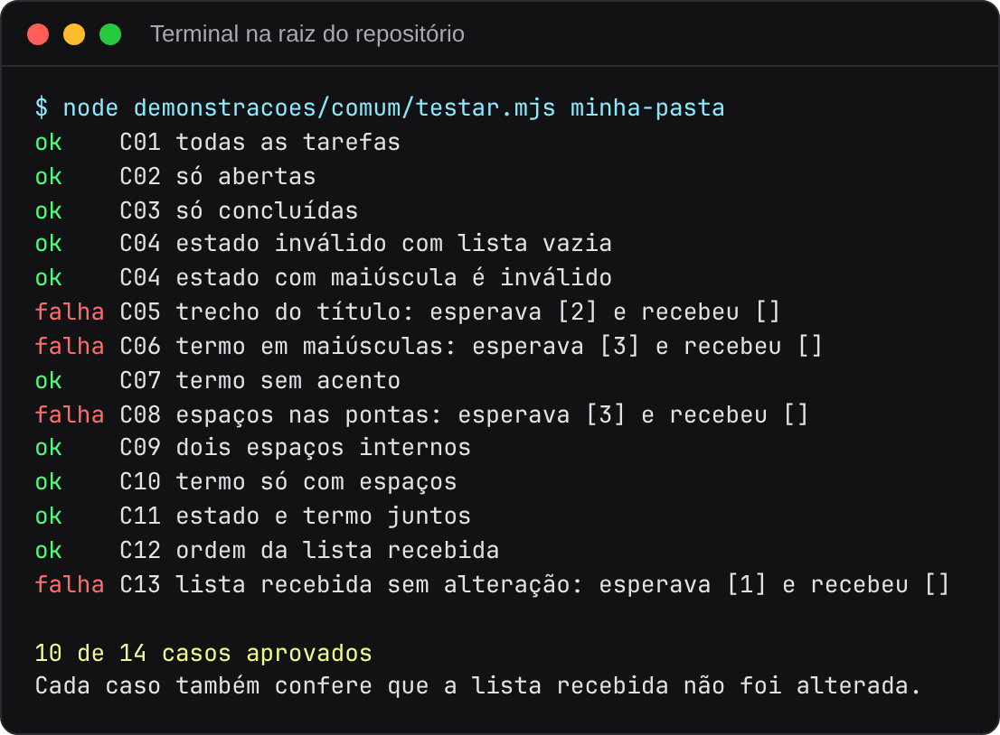

# Parte 1. Script de testes e artefatos de referência

[Voltar ao índice](README.md)

## O que a demonstração mostra

A pasta [demonstracoes/comum](../../demonstracoes/comum) guarda o que as outras demonstrações compartilham:

| Arquivo | Conteúdo |
|---|---|
| `pedido.md` | O pedido do suporte, sem dizer como tratar maiúsculas, acentos e espaços |
| `respostas-exemplo.md` | Onze respostas da pessoa responsável pelo pedido |
| `testar.mjs` | Script que executa os casos de teste contra a função e confere a cobertura dos critérios |
| `exemplo/` | Especificação, casos e implementação de referência, escritos à mão a partir das respostas |

O `testar.mjs` é o mesmo script que as demonstrações com Skills, subagents e MCP usam para verificar o trabalho do coder e do tester. Ele lê três arquivos de uma pasta:

```text
spec.md            critérios C01, C02... antes da seção "## Dúvidas"
casos.json         casos do tester, cada um com o critério que verifica
filtrarTarefas.ts  função entregue pelo coder
```

Cada caso roda a função com uma cópia da lista de tarefas, compara os IDs devolvidos com `esperadoIds` (ou a mensagem de erro com `esperadoErro`) e confere se a lista recebida continuou igual. No fim, o script lista os critérios da especificação que não têm nenhum caso.

## Pré-requisitos

Node.js 23.6 ou posterior no host. Sem essa versão, use o Node 22.23 da imagem Docker na seção [Sem Node na máquina](README.md#sem-node-na-máquina).

## Executar

Na raiz do repositório:

```bash
node demonstracoes/comum/testar.mjs demonstracoes/comum/exemplo
```



## Como ler o resultado

Cada linha traz `ok` ou `falha`, o critério e o nome do caso. O critério C04 tem dois casos, por isso são 14 casos para 13 critérios. A última linha confirma que todos os casos também conferem a lista recebida.

| Código de saída | Significado |
|---|---|
| 0 | Todos os casos passaram e todo critério tem caso |
| 1 | Algum caso falhou ou algum critério ficou sem caso |
| 2 | Arquivo ausente ou erro ao carregar a função |

Para ver o código de saída, rode `echo $?` no Linux e no macOS ou `$LASTEXITCODE` no PowerShell logo depois do comando.

## O que alterar para experimentar

Trabalhe numa cópia, para não alterar a referência.

```bash
cp -r demonstracoes/comum/exemplo minha-pasta
```

No PowerShell, use `Copy-Item -Recurse demonstracoes/comum/exemplo minha-pasta`.

### Introduzir um defeito no coder

Em `minha-pasta/filtrarTarefas.ts`, troque `tarefa.titulo.toLowerCase().includes(termo)` por `tarefa.titulo.includes(termo)`. O termo continua convertido para minúsculas, e o título passa a ser comparado como chega. Rode de novo apontando para a cópia:

```bash
node demonstracoes/comum/testar.mjs minha-pasta
```



Quatro casos falham, e cada falha mostra os IDs esperados e os recebidos. Os títulos usados nesses casos começam com maiúscula ("Comprar pão", "Revisar código", "Relatório"), então um termo em minúsculas deixa de encontrá-los. O caso de C13 também falha porque confere a lista sem alteração com o termo "relat", que depende da mesma conversão. O código de saída passa a ser 1.

### Remover a cobertura de um critério

Em `minha-pasta/casos.json`, apague o caso com `"criterio": "C07"`. Os casos restantes passam, e o script termina com `Critérios sem caso: C07` e código de saída 1. É assim que o processo cobra do tester um caso por critério.

### Comparar com outra especificação

Troque o texto de C07 em `minha-pasta/spec.md` por uma regra diferente das respostas, "Acentos não contam. relatorio encontra Relatório", e ajuste o caso de C07 em `casos.json` para esperar `[1]`. A implementação de referência passa a falhar nesse caso, porque segue a regra original. O script lê da especificação só os IDs. Quem garante que o caso corresponde ao texto do critério é o tester. O tester existe para encontrar esse tipo de falha, uma decisão da especificação que o código não cumpre.

Ao terminar, apague a pasta `minha-pasta`.
