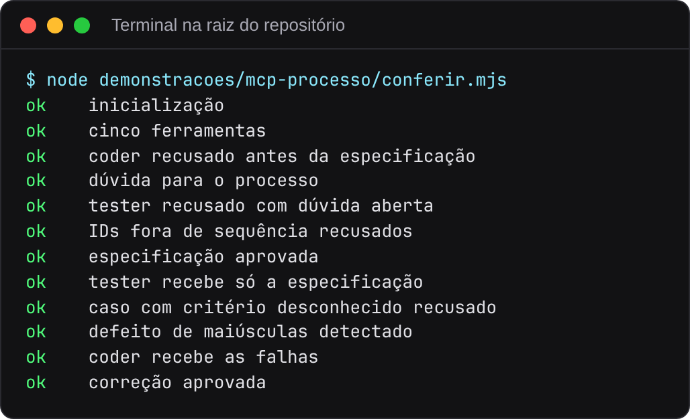
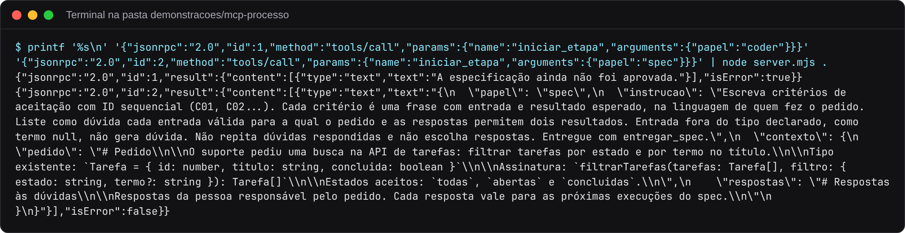
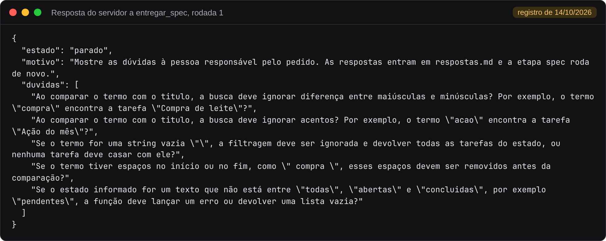
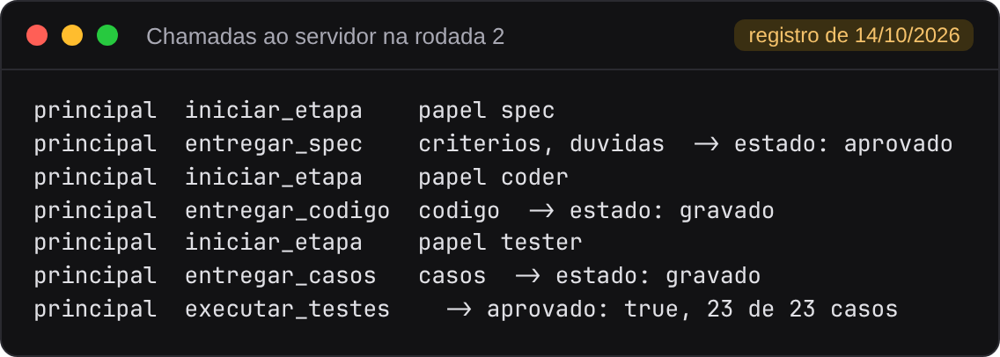

# Parte 2. Servidor MCP do processo

[Voltar ao índice](README.md)

## O que a demonstração mostra

O arquivo [server.mjs](../../demonstracoes/mcp-processo/server.mjs) é um servidor MCP sem dependências. Ele conduz as etapas spec, coder e tester por cinco ferramentas e recusa etapas fora de ordem. O modelo do host escreve especificação, código e casos. O servidor entrega a instrução e o contexto de cada papel, grava os artefatos em `saida/` e executa os testes.

| Ferramenta | Efeito |
|---|---|
| `iniciar_etapa` | Devolve instrução e contexto do papel. Coder e tester exigem especificação aprovada |
| `entregar_spec` | Grava `saida/spec.md`. Com dúvidas, o processo para |
| `entregar_codigo` | Grava `saida/filtrarTarefas.ts` |
| `entregar_casos` | Grava `saida/casos.json` e recusa caso com critério fora da especificação |
| `executar_testes` | Roda `../comum/testar.mjs` em outro processo, com prazo de 10 segundos |

A ordem das etapas fica no código do servidor. Um modelo que tente pular o spec recebe uma recusa, sem depender de instrução no prompt.

A demonstração tem dois caminhos. A conferência roda sem modelo, com um script que faz o papel do host. A execução com host usa um modelo de verdade.

## Conferência sem modelo

### Pré-requisitos

Node.js 23.6 ou posterior, ou o comando com Docker da seção [Sem Node na máquina](README.md#sem-node-na-máquina).

### Executar

Na raiz do repositório:

```bash
node demonstracoes/mcp-processo/conferir.mjs
```



### Como ler o resultado

O [conferir.mjs](../../demonstracoes/mcp-processo/conferir.mjs) inicia o servidor como processo filho e conversa com ele em JSON-RPC pela entrada e saída padrão, como um host MCP faz. Ele envia artefatos fixos e confere a resposta a cada passo.

| Controle | O que o servidor fez |
|---|---|
| inicialização, cinco ferramentas | Respondeu ao `initialize` com o nome `processo` e listou as cinco ferramentas |
| coder recusado antes da especificação | Recusou `iniciar_etapa` do coder sem spec aprovada |
| dúvida para o processo | Recebeu uma especificação com dúvida e mudou o estado para `parado` |
| tester recusado com dúvida aberta | Recusou o tester enquanto a dúvida estava aberta |
| IDs fora de sequência recusados | Recusou critérios que começam em C02 |
| especificação aprovada | Aceitou a especificação sem dúvidas |
| tester recebe só a especificação | Devolveu ao tester um contexto com a chave `especificacao` e nada mais |
| caso com critério desconhecido recusado | Recusou um caso que cita C09, ausente da especificação |
| defeito de maiúsculas detectado | Rodou os testes contra um código sem `toLowerCase` e reprovou |
| coder recebe as falhas | Incluiu a falha de C02 no contexto do coder |
| correção aprovada | Rodou os testes contra o código corrigido e aprovou |

O script trabalha numa pasta temporária `.conferencia-*` dentro da demonstração e a apaga no fim. Código de saída 0 quando os doze controles passam.

### O que alterar para experimentar

Converse com o servidor sem o script. Cada linha enviada é uma mensagem JSON-RPC. Primeiro faça a inicialização da conexão. Depois peça a etapa do coder antes da especificação e a etapa do spec. Esse início segue o [ciclo de vida do MCP](https://modelcontextprotocol.io/specification/2025-11-25/basic/lifecycle).

No Linux ou no macOS:

```bash
cd demonstracoes/mcp-processo
printf '%s\n' \
  '{"jsonrpc":"2.0","id":1,"method":"initialize","params":{"protocolVersion":"2025-11-25","capabilities":{},"clientInfo":{"name":"aula","version":"1.0.0"}}}' \
  '{"jsonrpc":"2.0","method":"notifications/initialized"}' \
  '{"jsonrpc":"2.0","id":2,"method":"tools/call","params":{"name":"iniciar_etapa","arguments":{"papel":"coder"}}}' \
  '{"jsonrpc":"2.0","id":3,"method":"tools/call","params":{"name":"iniciar_etapa","arguments":{"papel":"spec"}}}' \
  | node server.mjs .
```

No PowerShell, grave as quatro linhas JSON num arquivo `chamadas.jsonl` e rode `Get-Content chamadas.jsonl | node server.mjs .`.

A captura destaca as duas respostas de ferramentas. O comando atual imprime também a resposta de inicialização.



Depois da resposta de inicialização, a chamada do coder recebe `"isError": true` e a mensagem "A especificação ainda não foi aprovada." A chamada do spec traz a instrução do papel e o contexto, com o conteúdo de `pedido.md` e `respostas.md`. Esse é o texto que o modelo do host recebe quando chama `iniciar_etapa`. As duas chamadas não gravam nada em `saida/`.

Outras chamadas para testar à mão:

| Mensagem | Resultado esperado |
|---|---|
| `{"jsonrpc":"2.0","id":4,"method":"tools/list"}` | Lista das cinco ferramentas com o esquema de entrada de cada uma |
| `iniciar_etapa` com `"papel":"revisor"` | Recusa com a mensagem "Papel desconhecido." |
| `entregar_spec` com critérios C01, C02 e uma dúvida | Estado `parado` e gravação de `saida/spec.md` e `saida/spec.json` |

Depois de chamar ferramentas que gravam, apague a pasta `saida/` da demonstração.

## Execução com Antigravity ou Codex

1. Na raiz do repositório, rode `cd demonstracoes/mcp-processo`.
2. Inicie `agy` ou `codex` e aceite a confiança na pasta quando solicitado.
3. No Antigravity, confira `/mcp`. No Codex, rode `codex mcp list` no terminal desta pasta. Deve aparecer `processo`, configurado em `.agents/mcp_config.json` ou `.codex/config.toml`, respectivamente.
4. Peça `Execute o processo com o servidor processo: spec, coder, tester e testes.`
5. Com `respostas.md` vazio, o spec deve registrar dúvidas. Responda no arquivo ou copie `../comum/respostas-exemplo.md` sobre ele (`cp` em bash, `Copy-Item` no PowerShell), e repita o pedido.
6. Confira as chamadas a `iniciar_etapa`, as entregas e `executar_testes`. O resultado deve ter `aprovado: true`. Depois rode `node ../comum/testar.mjs` no terminal para conferir os artefatos.

Se o agente disser que o servidor não está conectado, pare e confira a confiança na pasta, o comando `node --version` e os arquivos de configuração. A conferência determinística acima continua disponível enquanto a conexão é resolvida. Os resultados dos hosts ficam no [relato de 15/10](../../evidencias/2026-10-15-agy-codex).

## Execução com Claude Code

### Pré-requisitos

Claude Code instalado, com acesso ao modelo pela sua conta ou por crédito de API. A configuração do servidor fica em `.mcp.json`. Para executar sem assinatura paga, use o caminho Antigravity descrito acima, conforme a cota disponível na conta.

### Executar

1. Abra o terminal em `demonstracoes/mcp-processo` e inicie o Claude Code com `claude`.
2. Confira a conexão com o comando `/mcp`. O servidor `processo` aparece com as cinco ferramentas.
3. Peça:

   ```text
   Execute o processo com o servidor processo: spec, coder, tester e testes.
   ```

4. Quando `entregar_spec` devolver dúvidas, o host as mostra. Responda na conversa ou escreva as respostas em `respostas.md`, e a etapa spec roda de novo. Para pular essa etapa, copie `../comum/respostas-exemplo.md` sobre `respostas.md`.

No Claude Code, o servidor também pode ser registrado pelo terminal:

```bash
claude mcp add --transport stdio --scope project processo -- node server.mjs .
```

### O que aparece na tela

O servidor foi executado com o Claude Code e o modelo Haiku em 14/10/2026, em duas rodadas. O relato completo está em [evidencias/2026-10-14-mcp](../../evidencias/2026-10-14-mcp). Naquela execução o host só tinha as cinco ferramentas do servidor, sem leitura de arquivos nem terminal.

Na rodada 1, com `respostas.md` só com o cabeçalho, o host chamou `iniciar_etapa` com o papel spec e entregou sete critérios e cinco dúvidas. O servidor respondeu assim a `entregar_spec`:



O campo `estado: parado` encerra a etapa. O host listou as cinco dúvidas para a pessoa responsável pelo pedido e não pediu `coder`, que o servidor recusaria de qualquer forma enquanto houver dúvida aberta.

Na rodada 2, com as respostas de `respostas-exemplo.md`, o host seguiu a ordem que o servidor libera. A lista abaixo foi extraída da [transcrição da rodada 2](../../evidencias/2026-10-14-mcp/rodada-2/transcricao.md) e mostra cada chamada, o argumento principal e o estado devolvido pelo servidor:



Os três papéis rodaram na mesma conversa, com o mesmo modelo. O servidor controla o que cada etapa recebe, e o modelo ainda tinha na memória o código que escreveu como coder quando chegou à etapa tester. A [parte 6](06-integrado.md) separa os papéis em subagents que chamam o mesmo servidor.

Ao final, `saida/` contém `spec.md`, `spec.json`, `filtrarTarefas.ts` e `casos.json`. O arquivo `falhas.txt` existe só enquanto algum caso falha, e o servidor o apaga quando os testes aprovam.

Para conferir o resultado sem confiar no relato do modelo, rode na mesma pasta:

```bash
node ../comum/testar.mjs
```

Para recomeçar, apague `saida/` e restaure `respostas.md` com `git checkout -- respostas.md`.

## Node não encontrado pelo host

O terminal e o processo que inicia o MCP podem receber ambientes diferentes. Se `codex mcp list` listar o servidor, mas a conexão falhar, localize o executável de Node com `command -v node` no Linux/macOS ou `(Get-Command node).Source` no PowerShell. Gerenciadores de versão podem devolver um shim. Use o caminho do executável de Node instalado no campo `command` de `.codex/config.toml`, mantendo `args` como estão, e reinicie o agente. No Windows, use barras `/` no caminho TOML ou escape as barras invertidas.

No ensaio isolado de 15/10, a conexão nativa funcionou ao indicar `/usr/bin/node` explicitamente para aquela execução. Esse caminho é específico da máquina do ensaio. A listagem do servidor, sozinha, não comprova que as ferramentas foram chamadas.

## Conferir os contratos das ferramentas

O servidor valida os argumentos antes de executar cada ferramenta. Ele recusa campos ausentes, tipos incorretos, propriedades extras, valores fora de `enum` e arrays abaixo de `minItems`. O validador cobre o subconjunto de JSON Schema usado neste exemplo. Para conferir as recusas sem modelo, execute na raiz:

```bash
node --test demonstracoes/mcp-processo/contratos.test.mjs
```

O teste envia oito entradas inválidas pelo transporte real, confere o erro JSON-RPC `-32602` e verifica que nenhum arquivo foi gravado. Depois envia uma especificação válida e confere que a conexão continua respondendo. Os doze controles de `conferir.mjs` avaliam o fluxo do processo separadamente.
