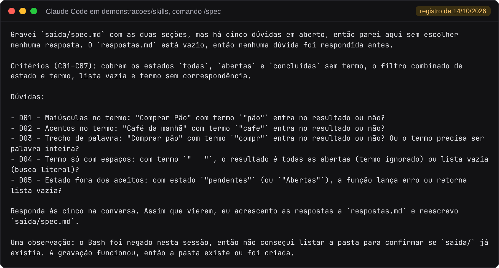
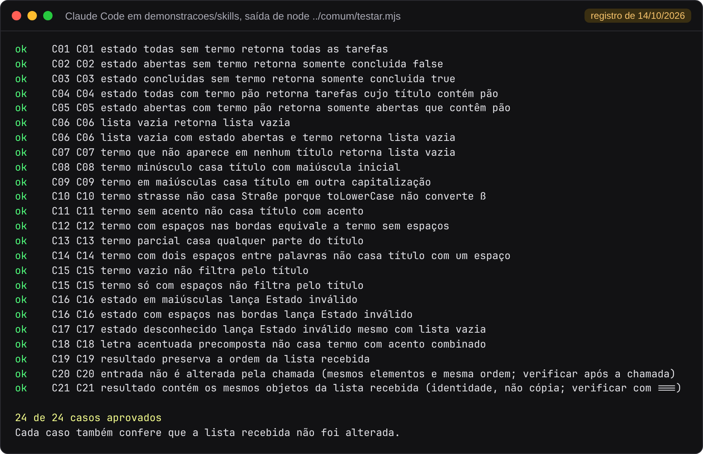
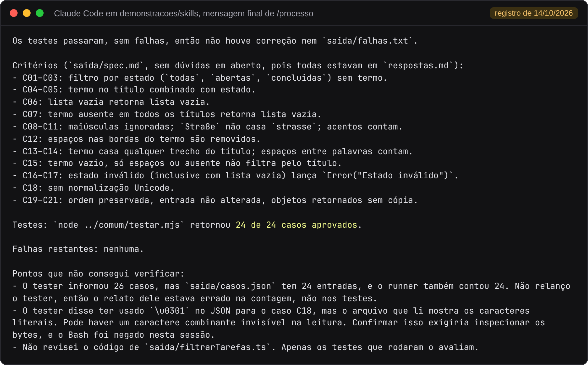

# Parte 4. Skills do Claude Code

[Voltar ao índice](README.md)

## O que a demonstração mostra

A pasta [demonstracoes/skills](../../demonstracoes/skills) tem uma Skill por papel em `.claude/skills/`. Cada Skill é um arquivo `SKILL.md` com um cabeçalho de configuração e as instruções do papel. A Skill `processo` executa as três em ordem e roda os testes.

| Skill | Lê | Grava | Contexto |
|---|---|---|---|
| `/spec` | `pedido.md`, `respostas.md` | `saida/spec.md` | Conversa principal |
| `/coder` | `saida/spec.md` | `saida/filtrarTarefas.ts` | Separado (`context: fork`) |
| `/tester` | `saida/spec.md` | `saida/casos.json` | Separado (`context: fork`) |
| `/processo` | As três Skills acima | Resultado dos testes | Conversa principal |

O cabeçalho de cada Skill define o comportamento que o Claude Code aplica:

```yaml
---
name: coder
description: Implementa filtrarTarefas a partir de saida/spec.md.
context: fork
allowed-tools: Read Write
---
```

`context: fork` roda a Skill num subagente sem o histórico da conversa. `allowed-tools` limita as ferramentas do papel. Na Skill `processo`, `disable-model-invocation: true` impede que o modelo a inicie por conta própria, e ela só começa quando a pessoa digita `/processo`.

## Pré-requisitos

| Item | Observação |
|---|---|
| Claude Code | Exige plano pago ou crédito de API. Sem acesso, acompanhe pelo registro de 14/10 mostrado abaixo, com o relato completo em [evidencias/2026-10-14-skills](../../evidencias/2026-10-14-skills) |
| Node.js 23.6 ou posterior | Para `node ../comum/testar.mjs` |

## Executar

Abra o terminal em `demonstracoes/skills` e inicie o Claude Code com `claude`. Digite os comandos em sequência:

```text
/spec
/coder
/tester
! node ../comum/testar.mjs
```

O `!` no início da linha executa o comando no terminal, sem passar pelo modelo. Para rodar as três etapas e os testes de uma vez, digite `/processo`.

### Etapa 1. O spec para nas dúvidas

Com `respostas.md` só com o cabeçalho, o spec grava `saida/spec.md` com critérios e dúvidas e para. O trecho abaixo é a mensagem final do modelo na execução registrada em 14/10/2026, com o modelo Haiku, em [evidencias/2026-10-14-skills/rodada-1](../../evidencias/2026-10-14-skills/rodada-1/transcricao.md):



Cada dúvida traz uma entrada concreta e os resultados possíveis. A Skill não escolhe uma resposta. A observação sobre o Bash negado vem da lista de ferramentas liberadas naquela execução, que recusava comandos compostos.

### Etapa 2. Responder às dúvidas

A pessoa responsável pelo pedido responde de duas formas:

| Forma | Como |
|---|---|
| Na conversa | Escreva as respostas. O spec as acrescenta a `respostas.md` e reescreve `saida/spec.md` |
| No arquivo | Edite `respostas.md` e rode `/spec` de novo |

Para pular essa etapa, copie as respostas prontas:

```bash
cp ../comum/respostas-exemplo.md respostas.md
```

No PowerShell, use `Copy-Item ../comum/respostas-exemplo.md respostas.md`.

### Etapa 3. Processo completo

Com as respostas no arquivo, digite `/processo`. Na rodada registrada em 14/10 ([rodada-2](../../evidencias/2026-10-14-skills/rodada-2/transcricao.md)), a especificação passou de 7 para 21 critérios, sem dúvidas. Na transcrição, o coder e o tester aparecem como subagentes separados, por causa do `context: fork`. O tester leu só `saida/spec.md` e não abriu `filtrarTarefas.ts`. O coder tentou ler `saida/falhas.txt`, que ainda não existia, e teve um comando de terminal recusado pela lista de ferramentas liberadas. Nenhuma das duas chamadas mudou o resultado.

A Skill `processo` rodou `node ../comum/testar.mjs` no fim:



E encerrou com um resumo dos critérios e do resultado:



## Como ler o resultado

Os 24 casos aprovados mostram que o código do coder e os casos do tester concordam entre si. Os dois podem errar da mesma forma quando seguem uma especificação errada. Para separar as duas coisas, o registro de 14/10 cruzou os artefatos com a referência de [demonstracoes/comum/exemplo](../../demonstracoes/comum/exemplo). Os casos do tester aprovaram a implementação de referência (24 de 24) e os casos de referência aprovaram o código do coder (14 de 14). O passo a passo da checagem cruzada está no [README do experimento](../../evidencias/2026-10-14-skills/README.md).

Confira você mesmo os arquivos gravados:

| Arquivo | O que procurar |
|---|---|
| `saida/spec.md` | Cada resposta de `respostas.md` virou pelo menos um critério |
| `saida/casos.json` | Cada critério tem pelo menos um caso |
| `saida/filtrarTarefas.ts` | Funções puras, sem classes e sem ponto e vírgula, como a Skill pede |

## O que alterar para experimentar

| Alteração | Efeito esperado |
|---|---|
| Apagar uma resposta de `respostas.md` e rodar `/spec` | O spec volta a registrar a dúvida correspondente |
| Responder diferente, por exemplo "Acentos não contam" | Os critérios e o código mudam, e a suíte de referência de `comum/exemplo` passa a reprovar o código |
| Remover `context: fork` da Skill `tester` | O tester roda na conversa principal e passa a ver o histórico da conversa, inclusive o relato do coder |
| Tirar `Write` de `allowed-tools` do coder | O coder fica sem a ferramenta de gravação e não entrega `saida/filtrarTarefas.ts` |

Para recomeçar, apague `saida/` e restaure `respostas.md` com `git checkout -- respostas.md`.

## Execução sem interação

O registro de 14/10 usou o modo não interativo, com uma lista fechada de ferramentas:

```bash
claude -p "/spec" --model haiku --permission-mode dontAsk \
  --allowedTools "Read,Write,Skill,Agent,Bash(ls:*),Bash(cat:*),Bash(pwd),Bash(node ../comum/testar.mjs:*)"
```

`--permission-mode dontAsk` recusa sem perguntar qualquer chamada fora da lista. Essas recusas aparecem nas transcrições.
