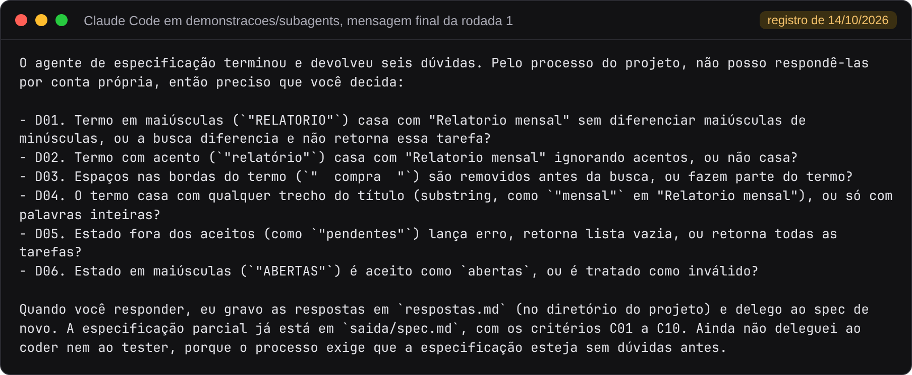
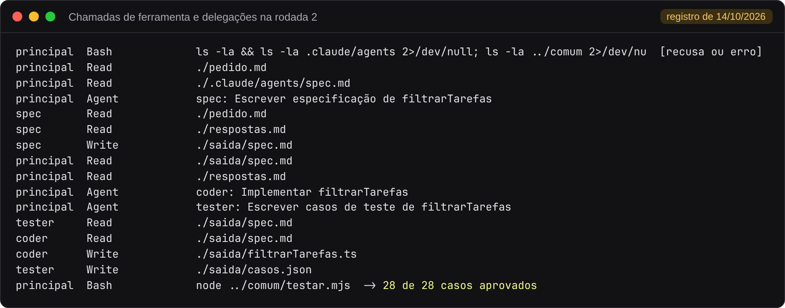

# Parte 5. Subagents

[Voltar ao índice](README.md)

## Executar com Antigravity ou Codex

Na raiz do repositório:

```bash
cd demonstracoes/subagents
```

| Agente | Iniciar | Definições dos papéis | Instrução da conversa principal |
|---|---|---|---|
| Antigravity | `agy` | `.agents/agents/spec.md`, `coder.md`, `tester.md` | `AGENTS.md` |
| Codex | `codex` | `.codex/agents/spec.toml`, `coder.toml`, `tester.toml` | `AGENTS.md` |

1. Inicie um dos agentes nesta pasta e aceite a confiança no repositório quando solicitado.
2. Peça `Execute o processo de desenvolvimento para pedido.md.`
3. Com `respostas.md` vazio, confira a delegação ao spec e as dúvidas em `saida/spec.md`. O processo deve parar para você responder.
4. Edite `respostas.md` ou copie o exemplo com `cp ../comum/respostas-exemplo.md respostas.md` (`Copy-Item` no PowerShell). Peça o processo novamente.
5. Confira se coder e tester foram delegados separadamente e receberam apenas o caminho da especificação. Rode `node ../comum/testar.mjs` no terminal para verificar os arquivos efetivamente entregues.

Os números de casos variam entre execuções. Uma mensagem final do modelo não comprova a delegação nem a aprovação: confira as chamadas aos subagentes e a saída do script. Os ensaios de 15/10 e seus limites ficam no [relato](../../evidencias/2026-10-15-agy-codex).

## Caminho com Claude Code e registro de 14/10

## O que a demonstração mostra

A pasta [demonstracoes/subagents](../../demonstracoes/subagents) tem um subagent por papel em `.claude/agents/`, com os nomes `spec`, `coder` e `tester`. Cada subagent roda com contexto próprio, recebe só o pedido da delegação e devolve um resumo à conversa principal.

| Peça | Arquivo | Função |
|---|---|---|
| Subagents | `.claude/agents/spec.md`, `coder.md`, `tester.md` | Instrução e ferramentas de cada papel (`tools: Read, Write`) |
| Processo | `CLAUDE.md` | Ordem das etapas, seguida pela conversa principal |
| Testes | `../comum/testar.mjs` | Verificação executada pela conversa principal |

Na parte 4, a pessoa chama cada Skill pelo nome. Aqui a conversa principal coordena o processo. O `CLAUDE.md` da pasta diz que ela não escreve especificação, código nem casos, e que delega cada etapa ao subagent do papel.

```text
1. Delegue ao agente spec.
2. Se o spec devolver dúvidas, mostre-as à pessoa e espere as respostas.
3. Com a especificação sem dúvidas, delegue ao coder e ao tester em paralelo.
4. Rode o comando node ../comum/testar.mjs.
5. Se algum caso falhar, envie as falhas ao coder. No máximo duas correções.
6. Informe os critérios, o resultado dos testes e as falhas que restarem.
```

O trecho acima resume o [CLAUDE.md](../../demonstracoes/subagents/CLAUDE.md) da pasta.

## Pré-requisitos

| Item | Observação |
|---|---|
| Claude Code | Exige plano pago ou crédito de API |
| Node.js 23.6 ou posterior | Para `node ../comum/testar.mjs` |

## Executar

Abra o terminal em `demonstracoes/subagents`, inicie o Claude Code com `claude` e peça:

```text
Execute o processo de desenvolvimento para pedido.md.
```

Para pular as dúvidas, copie antes as respostas prontas com `cp ../comum/respostas-exemplo.md respostas.md` (no PowerShell, `Copy-Item ../comum/respostas-exemplo.md respostas.md`).

## O que aparece na tela

A demonstração foi executada com o Claude Code e o modelo Haiku em 14/10/2026, em duas rodadas. O relato completo está em [evidencias/2026-10-14-subagents](../../evidencias/2026-10-14-subagents).

### Rodada 1. O spec devolve dúvidas

Com `respostas.md` só com o cabeçalho, a conversa principal delegou ao subagent `spec`. Subagents não fazem perguntas à pessoa, então o spec gravou `saida/spec.md` com dez critérios e seis dúvidas e devolveu o resumo. A conversa principal mostrou as dúvidas e parou:



A conversa principal não respondeu às dúvidas por conta própria, como pede o passo 2 do `CLAUDE.md`. Quando a pessoa responde, as respostas vão para `respostas.md`, e o spec roda de novo.

### Rodada 2. Delegações e testes

Com as respostas de `respostas-exemplo.md`, o processo foi até os testes. A lista abaixo foi extraída da [transcrição da rodada 2](../../evidencias/2026-10-14-subagents/rodada-2/transcricao.md) e mostra quem fez cada chamada. As linhas `Agent` são as delegações da conversa principal.



As duas delegações ao coder e ao tester saíram na mesma resposta da conversa principal, e as chamadas dos dois subagents se intercalam porque rodaram em paralelo. Cada um leu apenas `saida/spec.md`. A conversa principal leu arquivos e rodou os testes, sem escrever especificação, código nem casos. O primeiro comando de terminal foi recusado porque estava fora da lista de ferramentas liberadas naquela execução, e a recusa não mudou o resultado.

O comando `/agents` lista os três subagents da pasta.

### Uma dúvida que as respostas deixaram aberta

Segundo o relato do experimento, uma execução anterior da rodada 2, com as mesmas dez respostas, parou com uma dúvida nova. Quando nenhuma tarefa é descartada, o resultado é um array novo ou o próprio array recebido? A resposta 10 trata dos objetos, e não do array. Depois disso a resposta 11 entrou em `respostas-exemplo.md`. A mesma dúvida está registrada, com print, na [parte 6](06-integrado.md#rodada-2-uma-dúvida-que-as-respostas-deixaram-aberta).

## Como ler o resultado

Rode os testes você mesmo, sem depender do relato do modelo:

```bash
node ../comum/testar.mjs
```

A saída tem o mesmo formato da [parte 1](01-testes-de-referencia.md). Para conferir a independência do tester, procure na conversa as leituras feitas pelo subagent `tester`, como na lista da rodada 2. A instrução dele permite ler só `saida/spec.md`.

## O que alterar para experimentar

| Alteração | Efeito esperado |
|---|---|
| Trocar "em paralelo" por "em sequência" no `CLAUDE.md` | Coder e tester passam a rodar um depois do outro |
| Tirar o passo 2 do `CLAUDE.md` | A conversa principal pode seguir com dúvidas abertas ou respondê-las por conta própria |
| Acrescentar `model: haiku` a um subagent | Aquele papel roda com outro modelo, sem mudar os demais |

Para recomeçar, apague `saida/` e restaure `respostas.md` com `git checkout -- respostas.md`.
