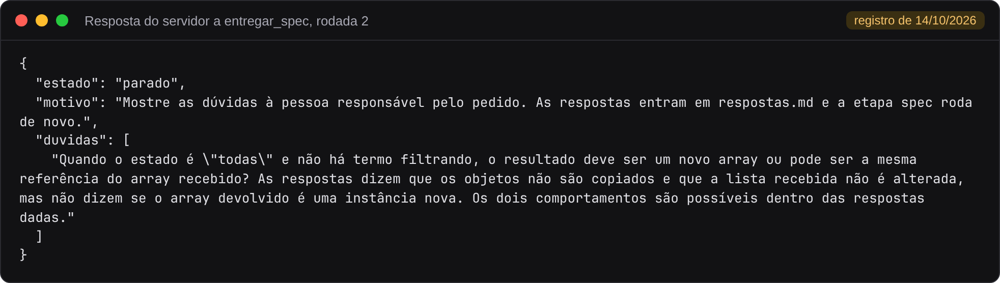
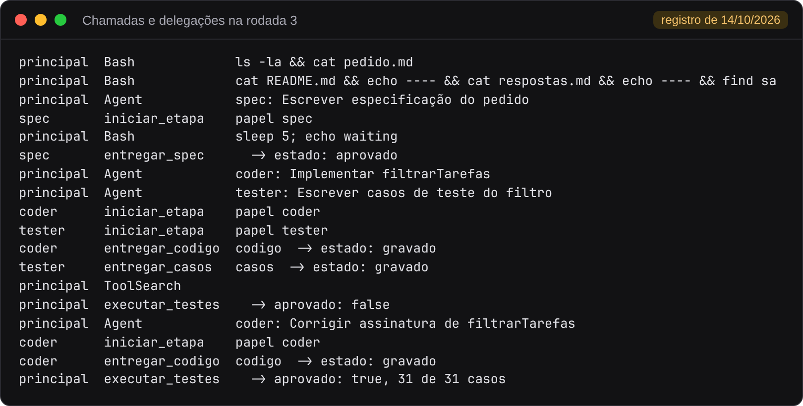
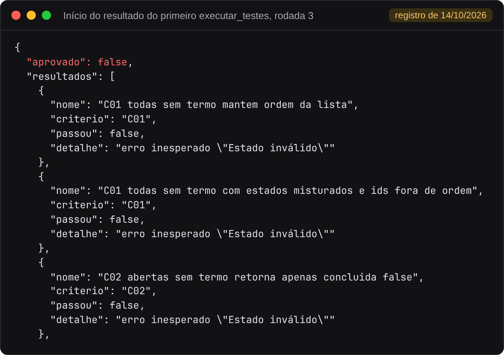
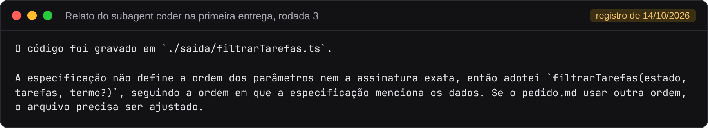

# Parte 6. Subagents, Skills e MCP combinados

[Voltar ao índice](README.md)

## O que a demonstração mostra

A pasta [demonstracoes/integrado](../../demonstracoes/integrado) junta as peças das partes 2, 4 e 5:

| Peça | Arquivo | Função |
|---|---|---|
| Subagents | `.claude/agents/` | Um papel por agente, com contexto próprio |
| Skills | `.claude/skills/criterios`, `.claude/skills/casos-de-teste` | Conhecimento carregado no subagent pelo campo `skills` |
| MCP | `.mcp.json`, `../mcp-processo/server.mjs` | Ordem das etapas, contexto de cada papel e gravação dos artefatos |
| Testes | `../comum/testar.mjs` | Verificação executada pelo servidor |
| Processo | `CLAUDE.md` | Sequência seguida pela conversa principal |

Cada subagent só tem as ferramentas do servidor que o papel usa:

```yaml
---
name: tester
tools: mcp__processo__iniciar_etapa, mcp__processo__entregar_casos
skills: [casos-de-teste]
---
```

O tester não tem `Read`. Ele recebe o contexto só por `iniciar_etapa`, que devolve a especificação sem o código. A separação vem da lista de ferramentas. Sem `Read`, o subagent não tem como abrir o arquivo de código.

## Pré-requisitos

| Item | Observação |
|---|---|
| Claude Code | Exige plano pago ou crédito de API |
| Node.js 23.6 ou posterior no host, ou a imagem Docker da parte 3 | O servidor MCP e o script de testes rodam com Node |

Antes, confira o servidor sem modelo, como na [parte 2](02-servidor-mcp.md):

```bash
node demonstracoes/mcp-processo/conferir.mjs
```

## Executar

1. Abra o terminal em `demonstracoes/integrado` e inicie o Claude Code com `claude`.
2. Aprove o servidor `processo` quando o Claude Code perguntar. O comando `/mcp` mostra a conexão.
3. Peça:

   ```text
   Execute o processo de desenvolvimento para pedido.md.
   ```

Para pular as dúvidas, copie antes `../comum/respostas-exemplo.md` sobre `respostas.md`. A mesma execução roda sem interação, com o servidor e as ferramentas da evidência:

```bash
claude -p "Execute o processo de desenvolvimento para pedido.md." --model haiku --permission-mode dontAsk \
  --strict-mcp-config --mcp-config .mcp.json \
  --allowedTools "Read,Write,Agent,mcp__processo__iniciar_etapa,mcp__processo__entregar_spec,mcp__processo__entregar_codigo,mcp__processo__entregar_casos,mcp__processo__executar_testes"
```

## O que aparece na tela

A demonstração foi executada com o Claude Code e o modelo Haiku em 14/10/2026, em três rodadas. A única diferença entre elas é o conteúdo de `respostas.md`. O relato completo está em [evidencias/2026-10-14-integrado](../../evidencias/2026-10-14-integrado).

| Rodada | `respostas.md` | Resultado |
|---|---|---|
| 1 | Só o cabeçalho | O spec devolveu sete dúvidas sem entregar a especificação |
| 2 | As dez primeiras respostas de `respostas-exemplo.md` | O servidor parou o processo com uma dúvida nova |
| 3 | As onze respostas | Testes reprovados, correção pelo coder e 31 de 31 casos aprovados |

### Rodada 2. Uma dúvida que as respostas deixaram aberta

O subagent `spec` recebeu pelo servidor o pedido e as dez respostas e entregou 25 critérios com uma dúvida. O servidor respondeu a `entregar_spec`:



As respostas diziam que os objetos não são copiados e que a lista recebida não muda. Nenhuma dizia se o array devolvido é novo. Para uma entrada válida, o estado `todas` sem termo, as duas leituras eram possíveis, e o spec registrou a dúvida em vez de escolher. A resposta 11 de `respostas-exemplo.md` ("O resultado é sempre um array novo...") foi escrita para fechar essa dúvida.

Nessa rodada o spec também tentou abrir `pedido.md`, `README.md`, `CLAUDE.md` e `respostas.md` com `Read` e recebeu erro, porque a definição do subagent só traz as ferramentas do servidor. O pedido e as respostas chegaram pelo contexto de `iniciar_etapa`.

### Rodada 3. Falha, correção e aprovação

Com as onze respostas, o processo completou o ciclo. A lista abaixo foi extraída da [transcrição da rodada 3](../../evidencias/2026-10-14-integrado/rodada-3/transcricao.md):



O servidor aprovou a especificação. A conversa principal delegou ao coder e ao tester na mesma resposta, e cada um pegou o contexto com `iniciar_etapa` e entregou pelo servidor. O primeiro `executar_testes` voltou com `aprovado: false`. A conversa principal delegou uma correção ao coder ("Corrigir assinatura de filtrarTarefas"), e o segundo `executar_testes` aprovou 31 de 31 casos, dentro do limite de duas correções.

A primeira execução dos testes começou assim:



Segundo o relato do experimento, 27 dos 31 casos falharam. A transcrição corta o resultado depois de 22 casos. Para conferir a contagem, a primeira versão do código, que está completa na transcrição, foi executada de novo com `testar.mjs` contra os casos da rodada 3 e terminou com 4 de 31 casos aprovados, com as 27 falhas por `erro inesperado "Estado inválido"`. Na mensagem em que delegou a correção, a conversa principal falou em dezessete falhas, número que não bate com o resultado.

### Por que o coder errou a assinatura

O relato do subagent coder na primeira entrega explica a escolha:



O coder entregou `filtrarTarefas(estado, tarefas, termo)`. O script de testes chama a função com a assinatura do pedido, `filtrarTarefas(tarefas, filtro)`, e a função recebia a lista no lugar do estado. Daí o erro "Estado inválido".

A causa está no servidor. `iniciar_etapa` monta o contexto de cada papel em `contextoDoPapel`, em [server.mjs](../../demonstracoes/mcp-processo/server.mjs):

| Papel | Contexto devolvido |
|---|---|
| spec | `pedido.md` e `respostas.md` |
| coder | `saida/spec.md` e `saida/falhas.txt` |
| tester | `saida/spec.md` |

A especificação gravada pelo servidor tem só critérios e dúvidas, sem a assinatura que está em `pedido.md`. O subagent coder tem apenas `iniciar_etapa` e `entregar_codigo` e, sem `Read`, não abre `pedido.md`. A mesma restrição que impede o tester de ler o código impediu o coder de ler a assinatura. Os casos do tester detectaram o erro, e a correção funcionou porque a conversa principal repassou a assinatura do pedido no texto da delegação. Na [parte 2](02-servidor-mcp.md), com o mesmo servidor e os papéis na mesma conversa, o coder acertou a assinatura.

## Como ler o resultado

Rode os testes na pasta da demonstração:

```bash
node ../comum/testar.mjs
```

Compare com as partes 4 e 5. Nas três, o resultado final é o mesmo conjunto de arquivos em `saida/`. O que muda é onde cada regra do processo fica:

| Regra | Skills | Subagents | Integrado |
|---|---|---|---|
| Ordem das etapas | Instrução da Skill `processo` | `CLAUDE.md` | Código do servidor MCP |
| Tester sem ver o código | Instrução da Skill | Instrução do subagent | Ferramentas do subagent |
| Execução dos testes | Comando liberado na Skill | Comando no `CLAUDE.md` | Ferramenta `executar_testes` |

## O que alterar para experimentar

| Alteração | Efeito esperado |
|---|---|
| Acrescentar `Read` às ferramentas do tester | O tester volta a poder abrir `saida/filtrarTarefas.ts`, e a separação depende de novo da instrução |
| Remover `skills: [casos-de-teste]` do tester | O tester deixa de receber as orientações de casos de teste da Skill |
| Pedir ao coder, na conversa, para entregar antes do spec | O servidor recusa a entrega |
| Incluir a assinatura no contexto do coder, em `contextoDoPapel` de `server.mjs`, ou exigir do spec um critério com a assinatura | O coder recebe a assinatura pelo servidor, e a primeira entrega deixa de depender de a conversa principal repassá-la |

Para recomeçar, apague `saida/` e restaure `respostas.md` com `git checkout -- respostas.md`.
